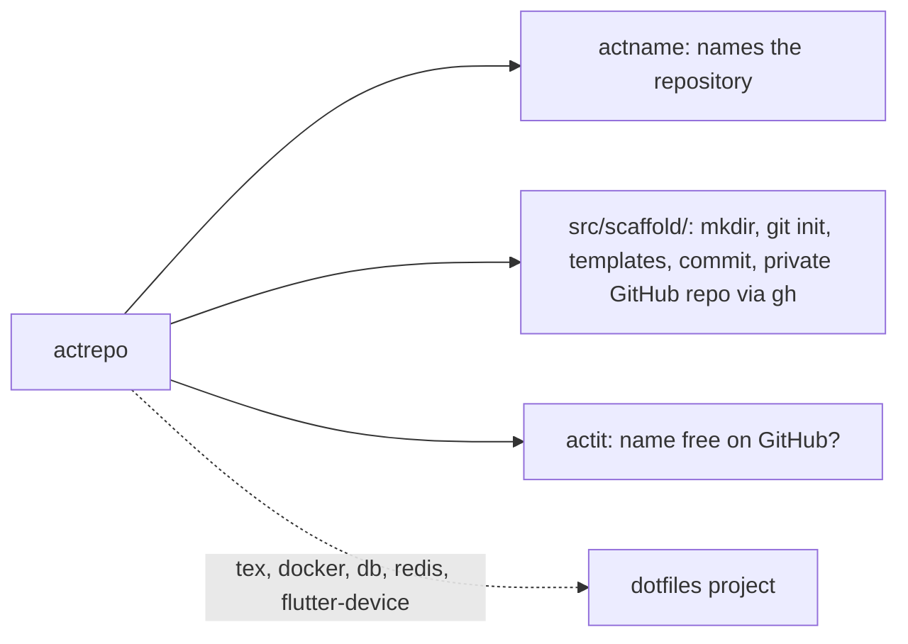

# actrepo

Manage git repositories by reusing what exists:

- **actname** (Rust library, pinned by commit) names the repository.
- **`repo` itself** scaffolds it (`src/scaffold/`: mkdir, git init, templates from `~/Source/dotfiles/project-templates`, commit, private GitHub repo via `gh`); `--via-dotfiles` uses the old `dotfiles project setup` instead.
- **`dotfiles project`** keeps only what is not repository management (`tex`, `docker`, `db`, `redis`, `flutter-device`); everything else lives in `repo` (see `CONTEXT.md`).
- **`actrepo` itself** scaffolds it (`src/scaffold/`: mkdir, git init, templates from `~/Source/dotfiles/project-templates`, commit, private GitHub repo via `gh`); `--via-dotfiles` uses the old `dotfiles project setup` instead.
- **`dotfiles project`** keeps only what is not repository management (`tex`, `docker`, `db`, `redis`, `flutter-device`); everything else lives in `actrepo` (see `CONTEXT.md`).
- **Prerequisites:** `git` and `gh` on `PATH`; templates are read from `~/Source/dotfiles/project-templates` (`PROJECT_REPO_ROOT` / `DOTFILES_REPO_ROOT` override the root).
- **actit** (Rust library, pinned by commit) checks that the name is free on GitHub, under any owner, through `gh`.

## Contents

- [How it works](#how-it-works)
- [Install](#install)
- [Usage](#usage)
- [Checks](#checks)

## How it works



## Install

Needs Rust 1.85 or newer, SSH access to GitHub (the actname and actit libraries are
fetched over ssh), `gh` authenticated (`gh auth login`) and `dotfiles` on `PATH`.

```bash
CARGO_NET_GIT_FETCH_WITH_CLI=true \
  cargo install --locked --git https://github.com/grosjeanbaptiste/actrepo
export PATH="$HOME/.cargo/bin:$PATH"
actrepo new package/rust --prefix act --domain "git repositories tooling" --dry-run
```

From a checkout: `cargo install --locked --path .` (`.cargo/config.toml` already sets
the git fetch). The binary is `~/.cargo/bin/actrepo`; update by re-running the first
command with `--force`, or with `actinstall update`.

## Usage

```bash
actrepo new package/rust --prefix act --domain "git repositories tooling" [--root ~/Source] [--no-push] [--dry-run]
actrepo new package/rust --name ifdck --no-push   # exact name, still checked
actrepo new package/rust --need "<need>" --prefix act --domain "<words>" [--force]   # ask actit first: a tool that already covers the need stops the run; --force creates anyway
# other `new` options: --max-length N (default 10), --limit N (default 20), --via-dotfiles (scaffold with `dotfiles project setup`)
actrepo check [path] [--type t]                    # audit a project against the templates
actrepo apply [path] [--type t] [--force|--diff]   # drop/refresh the standard files
actrepo license [path]                             # none | proprietary | open | other
actrepo list [--json] | scan [ROOT...] | status [NAME] [--json]   # machine-wide project registry ($DOTFILES_STATE_ROOT/projects.txt); --json for tools
actrepo actit "<need>" | --name N [--owner O] [--contains]   # actit in-process: does a tool exist / is a repository name taken (exit 0, 1; 2 is an error)
actrepo actname generate --prefix act --domain "<words>" [...]   # actname in-process: propose names
actrepo actautoma rename-repo OWNER/OLD NEW [--dir D] [--dry-run] # actautoma in-process (what `actrepo rename` wraps)
actrepo rename OWNER/OLD NEW [--dir DIR] [--into PARENT] [--local-only] [--dry-run]   # a repository renamed everywhere: platform, origin, folder, written references, registry row
actrepo move DIR --into PARENT [--fleet DIR]... [--dry-run]   # a folder and every repository under it (worktrees included) moved in one step; repos found by scanning, every path written in them corrected (actautoma move)
actrepo rename-branch [PATH] [--from master] [--to main] [--dry-run] [--delete-old] [--rewrite]   # default branch, local + GitHub; --rewrite edits the references in tracked files (all of `.github/`, `origin/OLD`, `heads/OLD`, "OLD branch" elsewhere), the rest stays a `warn:` line; nothing is committed
actrepo push [--dir PATH] [--dry-run] [--yes]      # push every nested repo that is clean and ahead; asks first
actrepo sync [DIR] [-n] [--pull-only] [--here]          # (--here: only the repository containing DIR, nothing scanned below it, success outside a repository: what a session start runs, fast) (--pull-only: only fast-forward what is behind, push nothing: what a session start runs) every branch of every repo under DIR: push what is ahead, fast-forward what is behind (fetch first), report diverged, dirty and upstream-less branches; one failure never stops the others, exit non-zero when any step failed or needs a human; the default branch is never pushed; -n prints the plan only A branch whose upstream has another name is fetched by that name; a branch checked out in another worktree is skipped (the path is named); with --pull-only a diverged or skipped branch is printed as `note` and does not fail the run.
actrepo pr create [--base B] [--title T] [--body D]    # PR for the current branch; title/description asked on stdin if not given
actrepo pr merge [N] [--yes]                           # merge commit (a CONFLICTING branch first gets the base merged into it; unresolvable conflicts are refused), branch deleted, base fast-forwarded locally, then, only once the head is verified contained in origin/BASE: the clean worktree holding it, the local branch and a leftover remote branch removed (a worktree with changes is kept, with a warning)
actrepo pr view [N]                                    # title, branches, author, state and mergeability of a PR (the current branch's when N is omitted)
actrepo pr list [--state open|closed|merged|all]       # one line per PR; open by default
actrepo pr retarget N BASE                             # change the base branch of a PR
actrepo pr close N [--comment C]                       # close a PR without merging it
actrepo worktree list [--json] [--owners]               # worktrees of the repository here: path, branch, main, detached, prunable; --owners adds the live agent sessions working in each (needs `actsessions` with `list --json`)
actrepo worktree prune [--base main] [-n]               # remove each clean worktree whose pushed branch is contained in origin/BASE, and the branch; also deletes each pushed local branch contained in origin/BASE that no worktree holds; `actrepo pr merge` runs it
actrepo hook install [DIR] [-n]                      # write the post-commit hook (never replaces another one); each commit then pulls (fast-forward) and pushes the branch in the background, log in $XDG_STATE_HOME/actrepo/hook.log; the default branch, a detached HEAD, a repository without origin and the emvi repositories are skipped; never a force, never --no-verify
actrepo hook sync                                      # the same pull and push, now, in the foreground
actrepo apply [PATH]                                   # in a git repository it also writes the post-commit hook (report line `post-commit hook`; `check` and `apply --diff` only report it)
actrepo workspace list | status | push [-n]            # folders of the nearest *.code-workspace ($DOTFILES_WORKSPACE_FILE overrides)
actrepo workspace add NAME [--clone URL | --init TYPE] # adopt ./NAME, or clone / scaffold it first
actrepo workspace remove NAME                          # forget the folder; the directory stays
actrepo install NAME [--package P] [--bin B] [--force]   # cargo install --path of a registered, clean, committed project, through the heavy queue
actrepo release [--require-audit] [--path DIR] [--script PATH] [ARGS...]   # run the project's release script with the profile and .envrc loaded
actrepo deploy ENV TARGET [PATH] [--project N] [-y] [--dry-run] [--store-page]   # build + publish: web (Cloudflare Pages), ios, android, mas, homebrew, windows, linux, `mobile` (ios, android and every desktop target), all
actrepo run NAME-OR-DIR [VERB [ARGS...]]               # run a Makefile target, melos script or cargo/flutter command (publish = actrepo deploy/release); no VERB lists them
actrepo doctor [PATH]                                 # one-glance health: git, open PRs and CI (gh via actautoma), TODO/FIXME, licence, audit
actrepo audit [PATH]                                  # env vars / CI secrets a project references, and where each is fulfilled
actrepo pin-propagate DEP [--rev REV] [--root DIR] [--gate "CMD"] [--dry-run] [--merge] # actautoma's verb: bump DEP in every repository that pins it, one pull request each, in dependency order
actrepo pin DEP [REV]                                  # where a git dependency is pinned across the workspace repos (fails when they differ); with a full 40-character REV, pins them all to it
actrepo completions zsh|bash                           # completion script: eval "$(actrepo completions zsh)"
actrepo <other command> …                              # forwarded to `dotfiles project` (e.g. `tex`)
```

Names whose directory exists, or that any GitHub owner already uses, are skipped.

## Checks

```bash
cargo test && cargo clippy --all-targets -- -D warnings
actqueue run --medium -- cargo test --test live -- --ignored   # real pipeline for ifdck, no GitHub write
```

Coverage of `actrepo new`: 36 unit tests (fakes), 10 CLI tests (no network), 17 live tests.
Cases covered: every project type; free, taken, invalid names (GitHub rules: 1 to 100 characters
of `A-Z a-z 0-9 . _ -`, not `.`/`..`, no `.git` suffix; unicode and symbols refused); `..`, `a/b`
and other non-single-component names; a directory, file or dangling symlink already there; missing
root, file as root, relative root, `~`, `~user`, missing `HOME`; actname refusals (prefix, length,
domain, limit); GitHub failing at once or half way (rate limit), invalid token, offline; missing
`gh` or `dotfiles`; unknown project type (no partial scaffold); two simultaneous runs (one wins);
forwarding of `dotfiles project` commands, success and failure.

`src/pipeline.rs` is the whole `actrepo new` flow with two injected seams (GitHub, `dotfiles`);
its tests run it for `ifdck` end to end with fakes. `tests/live.rs` runs the same flow for real
into a temp directory (`--no-push`: GitHub is only read).
